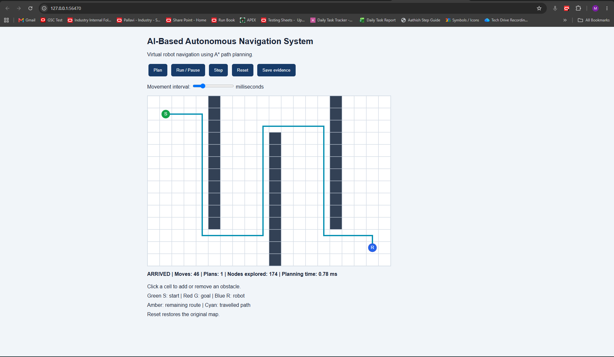
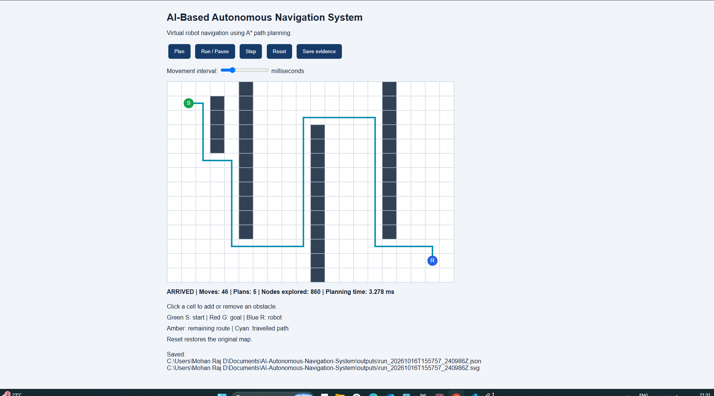
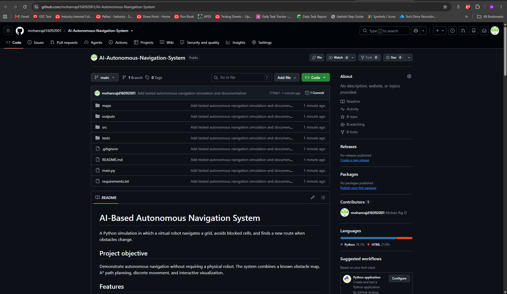

# AI-Based Autonomous Navigation System

A Python simulation in which a virtual robot navigates a grid, avoids blocked cells, and finds a new route when obstacles change.

## Project objective

Demonstrate autonomous navigation without requiring a physical robot. The system combines a known obstacle map, A* path planning, discrete movement, and interactive visualization.

## Features

- Warehouse-style grid simulation.
- A* shortest-path planning.
- Step-by-step or animated movement.
- Interactive obstacle placement and removal.
- Automatic replanning after obstacle changes.
- Unreachable-goal handling.
- JSON reports and SVG map exports.
- Automated tests.

## Technology

- Python 3.12.
- Python standard library.
- HTML, CSS, and JavaScript.
- Browser canvas for visualization.
- Local Python HTTP server.
- unittest for testing.

No external Python packages, GPU, model downloads, or physical hardware are required.

## Architecture

```text
JSON map / obstacle edits
          |
          v
Map validation and occupancy grid
          |
          v
A* planner
          |
          v
Movement controller
          |
          v
Browser visualization
          |
          v
JSON report and SVG image
```

Obstacle edits trigger a new plan from the robot's current position.

## Folder structure

```text
AI-Autonomous-Navigation-System/
├── maps/
│   ├── warehouse.json
│   └── blocked.json
├── src/
│   ├── world.py
│   ├── planner.py
│   ├── navigation.py
│   ├── export.py
│   ├── browser_ui.py
│   └── interface.html
├── tests/
│   └── test_navigation.py
├── docs/
├── evidence/
├── outputs/
├── main.py
├── requirements.txt
├── .gitignore
└── README.md
```

## Setup on Windows

Open the project folder in VS Code and use its terminal.

```powershell
python -m venv .venv
```

There are no external packages to install.

## Start the simulation

```powershell
.\.venv\Scripts\python.exe main.py
```

The application opens in your browser. If it does not open automatically, copy the local address printed in the terminal into your browser.

Keep the terminal running while using the simulation. Press Ctrl+C in that terminal to stop the server.

## Controls

1. Click Plan to generate a route.
2. Click Run / Pause to start or pause movement.
3. Click Step to move one cell.
4. Click a map cell to add or remove an obstacle.
5. Click Reset to restore the original map.
6. Click Save evidence to export the current run.

Start, goal, and the robot's current cell cannot be blocked.

### Map colors

- Dark cells: obstacles.
- Green S: start.
- Red G: goal.
- Blue R: robot.
- Amber line: remaining route.
- Cyan line: travelled path.

The robot marker covers the start or goal marker when they occupy the same cell.

## Run without the browser

```powershell
.\.venv\Scripts\python.exe main.py --headless
```

## Test an unreachable destination

```powershell
.\.venv\Scripts\python.exe main.py --headless --map maps/blocked.json
```

Expected result: NO_PATH with zero moves. This command returns exit code 2 to indicate that the goal was not reached.

## Run automated tests

```powershell
.\.venv\Scripts\python.exe -m unittest discover -s tests -v
```

The six tests cover:

- A* route lengths compared with an independent breadth-first search across 60 seeded maps.
- Replanning around a newly added obstacle.
- Unreachable destinations.
- Start equal to goal.
- Protected cells and controller reset.
- Exported files and invalid-map rejection.

## Verified results

| Scenario | Observed result |
|---|---|
| Original warehouse map | ARRIVED in 46 moves |
| Interactive obstacle changes | ARRIVED in 46 moves with 5 planning calls |
| Solid-wall map | NO_PATH with 0 moves |
| Automated tests | Six tests passed |

These results demonstrate the supplied grid scenarios. They do not establish performance in real environments.

## Saved outputs

Each saved run creates two timestamped files in outputs:

- JSON: status, trajectory, planning events, obstacle changes, and measurements.
- SVG: map, robot position, and route visualization.

Planning time measures planner execution, not total animation duration. An SVG export is a generated image, not a screenshot.

The evidence folder can hold selected screenshots and recordings captured during actual runs.

## Assumptions and limitations

- Obstacles are known grid cells, not objects detected by a camera.
- Movement uses four directions with equal step costs.
- The robot occupies a single grid cell.
- Obstacles remain stationary between user edits.
- The project uses classical AI search, not a trained neural network.
- There is no physical motor control, lane detection, or SLAM.

## Future improvements

Possible extensions from the project brief include camera input, object and lane detection, advanced simulation, ROS integration, SLAM, multiple robots, and hardware deployment.

## Troubleshooting

- If the browser cannot connect, check that the Python server is still running.
- If imports fail, run commands from the project root.
- If NO_PATH appears, inspect whether obstacles block every route.
- If a map fails to load, check JSON syntax and coordinate bounds.
- If PowerShell activation is restricted, use the direct .venv Python commands above.

## Author

Mohan Raj D.

## Demo screenshots

### Successful navigation
The robot reached the goal in 46 moves.



### Obstacle replanning
The robot reached the goal after added obstacles caused route replanning.



### Published repository

